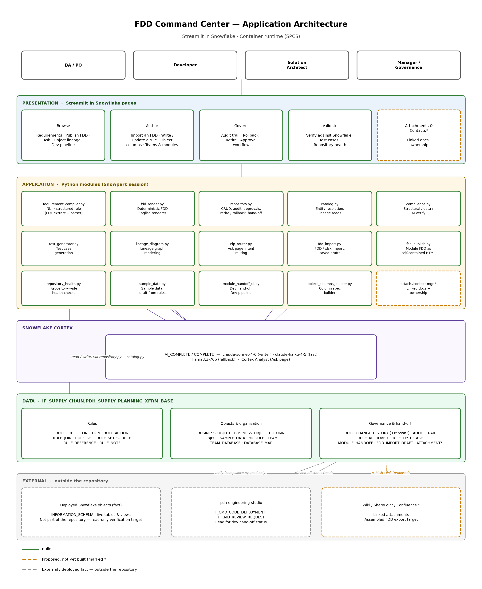
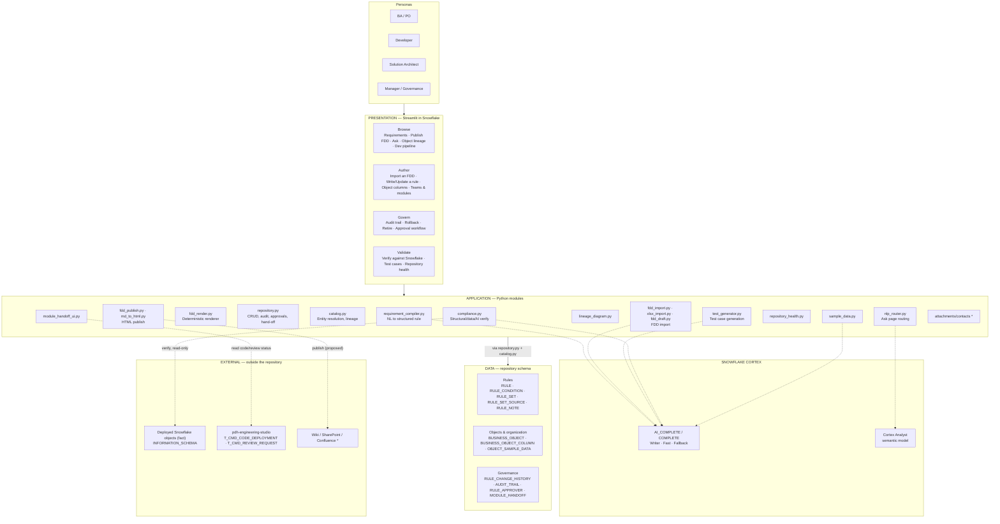

# Product Requirements Document — FDD Command Center

**Product:** Rule Repository App ("FDD Command Center")
**Platform:** Streamlit in Snowflake, container runtime (SPCS)
**Owning schema:** `IF_SUPPLY_CHAIN.PDH_SUPPLY_PLANNING_XFRM_BASE`
**Status:** Built and in use (updated October 2026). Phases 1–5 and 7 are built; Phase 6 is
partial. Each requirement in §6 carries its implementation status in brackets — **Built**,
**Partial** or **Not built / Not met** — checked against the code. See §6a for the open items
and §13 for capabilities added beyond the original scope.

---

## 1. Background and problem statement

Functional Design Documents (FDDs) for the supply chain data platform are currently authored
in Excel and, once finalized, manually converted into a wiki page so the specification and
contact information are centrally browsable. In practice this produces three recurring
problems:

1. **Drift.** The Excel spec and the deployed Snowflake object diverge over time. Nobody
   finds out until a downstream report breaks, because nothing checks the two against each
   other.
2. **Inconsistent, repetitive requirement text.** Free-text cells restate the same condition
   several different ways within one rule, and different authors use different words for the
   same concept across rules. No two rules read alike, and nothing can be automatically
   checked against them.
3. **No structure to query.** Questions like "which rules write to this column," "what feeds
   this view," and "has this been tested" require a person to read every relevant tab by hand.
   There is no single place to ask them.

We propose replacing the Excel-plus-wiki process with a structured rule repository: a
database-backed application that lets a business analyst still author in plain English, but
stores the result as a structured, queryable, versioned record that can be checked against the
real Snowflake objects and rendered back consistently for every reader.

## 2. Vision

A business analyst types a requirement in plain English. The system understands it, shows the
analyst exactly what it understood in one consistent voice, and — once confirmed — stores it as
a structured rule. From that point:

- A PO, developer, SA and manager can all read the same rule and mean the same thing by it.
- The system can tell you, automatically, whether that rule still matches what is deployed in
  Snowflake.
- The system can propose test cases that verify the rule against real data.
- The system can show how the object this rule writes to relates to everything upstream and
  downstream of it.
- Every change is attributable, reversible, and — where the business asks for it — reviewed
  before it counts as authoritative.

The wiki-style document PO/dev/SA/manager currently get from the Excel process is not being
discarded as a concept — it should still exist, generated *from* this structured store rather
than maintained by hand alongside it.

## 3. Goals

- Let a BA author a transformation rule in plain English and have it land as a structured,
  unambiguous record, not free text.
- Render every rule back in a single consistent voice, understandable by PO, developer, SA and
  manager alike, with no repeated or contradictory statements within one rule.
- Treat an object's declared column specification as a first-class, editable artifact,
  independent of whether the physical object exists in Snowflake yet — FDDs are routinely
  written before the table is built.
- Detect drift between the declared spec/rules and the deployed Snowflake objects
  automatically, and report precisely what differs and why.
- Maintain a complete, field-level history of every change, with the ability to roll back.
- Generate test cases from the rule definition itself, to reduce (not eliminate) the manual
  effort of verifying a rule against real data.
- Show how objects and rule sets connect to each other, scoped to the part of the platform a
  given team owns.
- Preserve everything the current Excel/wiki process carries — transformation logic, business
  rationale, parameter matrices, attachments and contact information — so nothing is lost in
  the transition.
- Introduce human-review guardrails appropriate to a system of record: a rule should not be
  treated as authoritative purely because a form was submitted.

## 4. Non-goals

- This is not an ETL orchestration tool. It documents and validates transformations; it does
  not execute them in production pipelines.
- This does not replace Snowflake as the system of record for data. `BUSINESS_OBJECT` /
  `BUSINESS_OBJECT_COLUMN` represent declared *intent*; `INFORMATION_SCHEMA` remains the
  deployed *fact*. The product must always be able to say which of the two it is showing.
- This is not a general-purpose data catalog on day one. Object discovery is scoped to objects
  a team has explicitly registered, not every object in the account.
- This does not aim to fully automate rule authorship. The LLM assists in structuring a
  requirement; a human remains responsible for confirming it is correct.

## 5. Personas

| Persona | What they need from the product |
|---|---|
| **Business Analyst (BA) / PO** | Author a rule without writing SQL. Read any existing rule and trust it says exactly what it does, in language they understand. Raise a review comment against a module. Know when a spec and Snowflake have diverged. |
| **Developer** | Get the exact target object, column, condition and action for a rule without re-reading an Excel cell to guess formatting. Know which columns still need a rule before starting to build. |
| **Solution Architect (SA)** | See how objects relate to each other (lineage). Confirm a rule set's source and target are wired correctly. Distinguish pass-through objects from genuinely transformed ones. |
| **Manager / governance stakeholder** | Confirm rules are reviewed before they become authoritative. See who changed what, when, and why. Retire a rule without losing its history. Trust that automated checks (verify, test generation) support human judgment rather than substitute for it. |

## 6. Scope — proposed feature set

Organized as build phases. Phase 1 is the minimum that replaces the core Excel authoring loop;
later phases add the governance, publishing and validation depth the business has asked for.

### Phase 1 — Core authoring and reading

| Capability | Requirement |
|---|---|
| Plain-English rule authoring | A BA enters a requirement in plain English, targeting a rule set and (optionally) named source/target objects. The system parses it into structured conditions, actions and joins. *(FR-1)* **[Built]** |
| Compiled preview before save | Before anything is written, the system shows the rule rendered back as FDD-style English, plus any blocking errors and any non-blocking warnings (e.g. missing business description). *(FR-2)* **[Built]** |
| Deterministic rendering | Reading a rule back to English must not depend on an LLM call — the same rule renders identically every time, for every reader. *(FR-3)* **[Built]** |
| No repeated or contradictory statements | The renderer must not restate a fact already implied elsewhere in the same rule (e.g. a condition already covered by the headline should not also appear as a separate bullet). *(FR-4)* **[Built]** |
| Update an existing rule | A BA can describe a change in plain English against an existing rule and see a preview of the resulting change before confirming. *(FR-5)* **[Built]** |
| Manual field-level entry | For cases the plain-English path cannot express precisely, allow direct edit of rule, condition and action fields. *(FR-6)* **[Built]** |
| Requirements browser | Read rules as FDD English, filterable by module and object, with inline sample-data preview from the live object. *(FR-7)* **[Built]** |
| Natural-language Q&A | Answer questions about rules, columns or data by routing to metadata lookup, structured query, or an LLM answer as appropriate, scoped to an explicit allow-list of queryable objects. *(FR-8)* **[Built]** |

### Phase 2 — Object and column management

| Capability | Requirement |
|---|---|
| Declare columns before the object exists | An object's column specification can be declared and edited whether or not the physical table/view exists in Snowflake yet, since FDDs are routinely written ahead of the build. The system states this explicitly rather than blocking it. *(FR-9)* **[Built]** |
| Column origin | Every declared column records how it got there: a straight pull from a source, something requiring transformation logic, or something read back from Snowflake without vetted intent. *(FR-10)* **[Built]** |
| Non-destructive sync from Snowflake | Reading real columns back from Snowflake to seed the spec must never overwrite a column's hand-written description or reclassify its declared origin. *(FR-11)* **[Built]** |
| Gap detection | A column that needs transformation logic but has no linked rule must be flagged. A straight pass-through column with no rule is expected and must not be flagged. *(FR-12)* **[Built]** |
| Declared-vs-built comparison | Compare the declared specification against the live object in both directions: declared-but-not-built, and built-but-not-declared. *(FR-13)* **[Built]** |
| Team and module organization | Objects and rule sets are grouped by module, modules by team, so a team sees only what it owns. *(FR-14)* **[Built]** |

### Phase 3 — Governance and human review

This phase exists because "author it and it's saved" is not sufficient for a system of record.

| Capability | Requirement |
|---|---|
| Required justification on save | Saving or updating a rule requires the author to state, in a short free-text field, why the rule is needed or why the change is being made. This must be stored on the change record, not only implied by the diff. *(FR-15)* **[Partial — reason required only for Retire and Request changes]** |
| Explicit confirmation step | The rendered preview must be something the author affirmatively confirms (not simply a click on a button that also submits), so a rule cannot be saved without the author having seen how it reads. *(FR-16)* **[Built]** |
| Reversible retirement | Removing a rule from active use must be reversible: require a reason, mark it retired rather than deleting it, and allow it to be restored later with full history intact. *(FR-17)* **[Built]** |
| Full audit trail | Every field-level change and every repository mutation must be attributable to a user and a timestamp, and exportable. *(FR-18)* **[Built]** |
| Deterministic rollback | Restoring a prior version of a rule must be a mechanical replay of its recorded history — not a re-interpretation by an LLM. *(FR-19)* **[Built]** |
| Review workflow *(needs a scoping decision — see §9)* | The business has asked for accountability beyond an audit trail: at minimum, a required reason; at most, a formal draft → in-review → approved workflow with a reviewer distinct from the author. The build should start with the required-reason baseline and add a review workflow only once the business confirms which weight it wants (see Open Questions). *(FR-20)* **[Built — DRAFT / CHANGES_REQUESTED / ACCEPTED with per-team approvers (`RULE_APPROVER`)]** |

### Phase 4 — Verification

| Capability | Requirement |
|---|---|
| Structural check | For every rule, confirm the columns it names actually exist on the relevant object — distinguishing "column is missing" from "object isn't built yet, so this can't be verified" rather than conflating the two. *(FR-21)* **[Built]** |
| Data check | Run each rule's condition against live data and report actual violations, not just structural presence. *(FR-22)* **[Built]** |
| AI-assisted logic review | For rules with a confirmed data violation, use an LLM to assess whether the object's actual structure still matches what the rule claims — gated to violation cases only, to bound cost. *(FR-23)* **[Built]** |
| Generated test cases | Propose one to two functional test cases (positive/negative path) and one data-quality check per rule, each as an executable SQL query, generated from the rule's own definition. *(FR-24)* **[Built]** |
| Test case review status | Generated cases must default to an unreviewed status and require an explicit accept/reject action before being treated as validated — automated generation should never silently count as human verification. *(FR-25)* **[Not met — both save paths write `ACCEPTED`]** |
| Editable, re-runnable cases | A generated or manual test case's SQL can be edited and re-run individually, and failing queries get one automated repair attempt. *(FR-26)* **[Built]** |

### Phase 5 — Lineage and relationships

| Capability | Requirement |
|---|---|
| Object lineage diagram | Render source → target flow across registered objects. *(FR-27)* **[Built]** |
| Module-scoped lineage | Scoping to one module must filter the connections shown, not just the starting points, and must visually distinguish objects that sit outside the selected module rather than silently expanding into it. *(FR-28)* **[Built]** |
| Rule-to-rule relationships | Where one rule's output depends on or references another, that relationship should be capturable and visible, not only inferable from reading both rules. *(FR-29)* **[Partial — `RULE_REFERENCE` rendered in rule text, not authorable]** |

### Phase 6 — Documentation, publishing and preserved context

The business has been explicit that nothing the current Excel/wiki process carries may be lost.

| Capability | Requirement |
|---|---|
| Business rationale on every rule and object | Every rule and object specification must have a place to record *why*, not only *what* — a business description field, populated by the author (assisted by the LLM extraction pass) and treated as expected, not optional. *(FR-30)* **[Partial — blank description warns, does not block]** |
| Parameter matrix | The structured equivalent of the Excel parameter-matrix tabs must be capturable and must appear in the published output, not only exist in a side table nobody exports. *(FR-31)* **[Not built — parameter matrix not in any export]** |
| Attachments / supporting information | A rule, rule set or module must be able to reference supporting documents. Given the existing documents already live in other systems, the initial approach should link to them in place rather than duplicate them into Snowflake storage (see §9). *(FR-32)* **[Not built]** |
| Contacts and ownership | A rule set, module or object must be able to record who to contact about it — an explicit gap in the current design where only "who last touched it" is captured, not "who owns it." *(FR-33)* **[Not built]** |
| Publishable output | Produce a single assembled document per FDD (rule set) — rationale, transformation logic, parameter matrix, column specification, relationships, and supporting links together — suitable for publishing to a wiki or equivalent, in addition to the existing per-page CSV/Markdown exports. *(FR-34)* **[Partial — Publish FDD exports one module as self-contained HTML; parameter matrix, attachments and contacts not included]** |

### Phase 7 — Repository-wide health

| Capability | Requirement |
|---|---|
| Coverage dashboard | A single view reporting, across the whole repository: rules with no actions, objects with no columns, derived columns with no linked rule, rule sets with no lineage connection, and objects not yet built in Snowflake. This must exist as an aggregate, not only be discoverable one object or rule at a time. *(FR-35)* **[Built]** |

## 6a. Open requirements

| FR | Gap | Suggested next step |
|---|---|---|
| FR-15 | Write, Update and Rollback save without a reason; `RULE_CHANGE_HISTORY` has no reason column | Add `CHANGE_REASON` to `RULE_CHANGE_HISTORY` and a required field on those three pages |
| FR-25 | Generated test cases are saved as `ACCEPTED` | Save as `SUGGESTED`; accept explicitly on Run & Review |
| FR-29 | Rule references can be read but not authored | Add references to Manual entry and to lineage |
| FR-30 | Blank business description only warns | Make it blocking in the compiler |
| FR-31 | Parameter matrix not exported | Add the metadata matrix to Publish FDD |
| FR-32, FR-33 | No attachments/links, no owner/contact fields | Link-in-place table plus owner/contact columns on `MODULE` / `RULE_SET` |
| FR-34 | HTML per module only | Add the missing sections; decide on wiki push (§9) |

## 7. Data model

Three groupings, all under one schema:

- **Rules** — `RULE`, `RULE_CONDITION`, `RULE_ACTION`, `RULE_JOIN`, `RULE_JOIN_COLUMN`,
  `RULE_JOIN_FILTER`, `RULE_MAPPING`, `RULE_REFERENCE`, `RULE_SET`, `RULE_SET_SOURCE`.
  `RULE_SET_SOURCE` is a junction table (a rule set can have more than one source object) and
  is what any lineage feature must read — a rule set with no row here would be invisible to
  lineage regardless of what a single source/target column on `RULE_SET` says. This is a
  design constraint to get right from the start, not a retrofit.
- **Objects and organization** — `BUSINESS_OBJECT`, `BUSINESS_OBJECT_COLUMN`, `MODULE`,
  `TEAM`, `TEAM_DATABASE`, `DATABASE_MAP`, `USER_PREFERENCE`, `AGENT_ALLOWED_OBJECT`.
- **Governance and validation** — `RULE_CHANGE_HISTORY` (a dedicated reason column is still
  outstanding, per FR-15), `AUDIT_TRAIL`, `RULE_APPROVER`, `RULE_REVIEW_COMMENT`, `RULE_NOTE`,
  `RULE_TEST_CASE` (status column defaults to `SUGGESTED`, but the app writes `ACCEPTED` —
  FR-25), `T_MOCK_METADATA_HEADER` / `T_MOCK_METADATA_DETAIL` (the parameter matrix). Tables
  for attachments/links and contacts (FR-32/FR-33) are not yet built.
- **Built beyond the original model** — `OBJECT_SAMPLE_DATA` (sample rows per object),
  `FDD_IMPORT_DRAFT` / `FDD_IMPORT_DRAFT_PART` (saved import reviews), `MODULE_HANDOFF`
  (dev lifecycle decisions), one `SEQ_<TABLE>` sequence per table for surrogate keys, the
  views `VW_MODULE_DEV_STATUS`, `VW_MODULE_DEV_OBJECTS`, `VW_RULE_CHANGES_FOR_DEV`, and the
  procedure `SP_SET_MODULE_DEV_STATUS`.

A denormalized read view over the rule tables should back the Requirements browser and any
other high-frequency read path, so day-to-day browsing doesn't join eight tables per page load.
Any such view must be paired with an explicit rule for whether retired rules are included,
stated once, not left to whichever page happens to query it.

## 8. Non-functional requirements

- **Determinism where it matters.** Rendering a rule to English and replaying a rollback must
  not depend on an LLM — a PO or auditor must get the same answer every time. *(NFR-1)*
- **LLM cost containment.** Use a fast/cheap model for structured extraction, classification
  and test generation; reserve a larger model for prose-heavy compilation. Gate any AI-assisted
  review to cases already flagged by a cheaper deterministic check, not run indiscriminately.
  *(NFR-2)*
- **No destructive automation.** Any automated sync or generation step must be additive by
  default — it must not overwrite human-authored content or silently mark generated output as
  reviewed. *(NFR-3)*
- **Cache correctness over cache speed.** Reads should be cached, but a write must be visible
  immediately to the user who made it; prefer versioned invalidation over full cache clears.
  *(NFR-4)*
- **Retire, don't delete.** No user-facing action should be an unrecoverable hard delete of a
  rule. *(NFR-5)*
- **Team-scoped visibility.** A team should see its own modules, objects and rule sets by
  default; cross-team visibility should be an explicit choice, not the default. *(NFR-6)*

## 9. Open questions to resolve before/during build

- **Review-gate weight — RESOLVED.** Built as a DRAFT → CHANGES_REQUESTED → ACCEPTED
  workflow with per-team approvers (`RULE_APPROVER`), plus a module-level hand-off to
  development. The required-reason-on-every-save baseline (FR-15) is still outstanding.
  Original question, kept for context:
  **Review-gate weight (blocks FR-20).** Is a required-reason field on every save sufficient,
  or does the business need a formal submit → approve workflow with a reviewer distinct from
  the author before a rule is `ACTIVE`? These differ materially in build cost and in how every
  future rule reaches active status. Recommend starting with the required-reason baseline and
  revisiting after the first review cycle.
- **Attachment storage model (blocks FR-32).** Should attachments be uploaded into a Snowflake
  stage, or should the initial version only link out to documents that already live in
  SharePoint/Confluence/the existing wiki? Recommend linking-in-place first — it has no storage
  or staleness question and is materially less to build.
- **Publish format — PARTLY RESOLVED.** A single assembled, self-contained HTML export per
  module is built (Publish FDD). Push integration to a wiki platform remains undecided.
  Original question: **Publish format (blocks FR-34).** Is a single assembled export (Markdown and/or HTML) the
  right shape for "publish to a wiki," or does publishing need push integration to an actual
  wiki platform? Recommend the assembled export first; automatic push is a larger, separate
  scope decision.
- **Validation before rollout.** The business has asked that the approach be validated against
  both a simple use case (e.g. a single pass-through view) and a complex one (multi-condition,
  multi-join, with data-quality rules) before any large-scale migration off the current
  process. This should be a scheduled milestone, not an implicit assumption.
- **Migration path.** What, if anything, does the current wiki-based process provide that this
  product does not yet replace (e.g. full-text search across all specs, page-level permissions,
  informal comment threads)? This should be answered explicitly before committing to
  decommissioning the existing process.

## 10. Success metrics

| Metric | Why it matters |
|---|---|
| % of active rules with zero structural gaps in Verify | Direct measure of spec-to-Snowflake drift |
| % of derived columns with a linked rule | Measures completeness of the FDD, not just its existence |
| % of accepted test cases that went through an explicit accept action, not a bulk default | Measures whether test generation supports review or quietly bypasses it |
| Median time from "requirement typed" to "rule saved" | Core authoring efficiency claim versus the Excel process |
| % of rule sets with a populated lineage connection | Health of the lineage graph, which several other features depend on |
| % of retired rules with a substantive reason | Governance quality, not just governance existence |
| % of FDDs with a published, assembled export available | Measures whether the wiki-replacement goal is actually being met |

## 11. Milestones

| Milestone | Status |
|---|---|
| **M1 — Core loop:** Phase 1 (author, preview, read back) end-to-end on one module | Done |
| **M2 — Object model:** Phase 2 (columns, origin, gap detection) | Done |
| **M3 — Governance baseline:** retirement, audit trail, rollback, required reason | Done, except the required reason on every save (FR-15). Approval workflow added |
| **M4 — Verification:** Phase 4 | Done, except explicit review of generated test cases (FR-25) |
| **M5 — Lineage:** Phase 5 | Done; rule-to-rule relationships partial (FR-29) |
| **M6 — Publishing:** Phase 6, validated by producing one real FDD and a stakeholder review against the wiki page | Partial — HTML Publish FDD built; parameter matrix, attachments, contacts outstanding; stakeholder review not recorded here |
| **M7 — Repository health:** Phase 7 | Done (Repository health page) |
| **M8 — Dev hand-off:** module lifecycle shared with pdh-engineering-studio (added, see §13) | Done |
| **Validation gate (before full rollout):** simple and complex use-case validation from §9, explicit sign-off before migrating more teams | Open — to be scheduled |

## 12. Application architecture

Rendered diagram: `architecture_diagram.png` (regenerate with
`python3 generate_architecture_diagram.py`). Updated October 2026; the Mermaid diagram below
shows the same content.

Six layers, top to bottom:

- **Presentation** — the Streamlit pages, grouped by intent: Browse (Requirements, Publish
  FDD, Ask, Object lineage, Dev pipeline), Author, Govern and Validate (including Repository
  health).
- **Application** — one Python module per concern. `requirement_compiler.py` and
  `fdd_render.py` are deliberately separate modules: compiling English into a structured rule
  and rendering a structured rule back into English are different operations with different
  correctness requirements (one may use an LLM, the other must not), and keeping them apart is
  what lets FR-3 (deterministic rendering) hold regardless of what the compiler does.
  `fdd_publish.py` reuses the renderer and lineage code so a published document cannot drift
  from the app.
- **Snowflake Cortex** — the only place an LLM is called from: rule compilation and FDD
  import extraction, test generation, the AI-assisted logic review tier, sample-data drafting,
  and the Ask page (routing tie-breaks and Cortex Analyst). Models: `claude-sonnet-4-6`
  (writer), `claude-haiku-4-5` (fast), `llama3.3-70b` (fallback).
- **Data** — the repository schema itself, i.e. declared intent. Split into Rules,
  Objects & organization, and Governance, matching §7.
- **External** — deliberately drawn *outside* the repository box: the live Snowflake objects
  that Verify checks against, pdh-engineering-studio's code and review tables that the dev
  hand-off reads, and the (still proposed) wiki publish targets.

Items marked `*` are proposed and not yet built.

Portable (Mermaid) diagram:

## 13. Built beyond the original scope

| Capability | What it does |
|---|---|
| Whole-FDD import | Paste an FDD or upload the `.xlsx` workbook; every section, object, column spec, sample row and numbered rule is shown for review, including lines that could not be placed, then written in one transaction |
| Saved import drafts | An import review survives reload, timeout and redeploy (`FDD_IMPORT_DRAFT`) |
| Approval workflow | `DRAFT` / `CHANGES_REQUESTED` / `ACCEPTED`, per-team approvers, reason required to request changes, edits to accepted rules return them to review |
| Module hand-off to development | `IN_REVIEW → READY_FOR_DEV → IN_DEV → DEV_COMPLETED`, shared with pdh-engineering-studio through views and `SP_SET_MODULE_DEV_STATUS`; rule changes since hand-off are tagged `LOGIC` / `WORDING`. See `ENGINEERING_STUDIO_INTEGRATION.md` |
| Sample data | Sample rows for objects not yet built — typed, imported from the FDD, or drafted from the rules with per-cell origin |
| Rule notes | Free-text notes on a rule, outside its logic and change tracking for dev |
| Atomic surrogate keys | One `SEQ_<TABLE>` sequence per table replaces `MAX(id)+1` |
| Automated tests | 26 unit-test modules under `tests/` |
